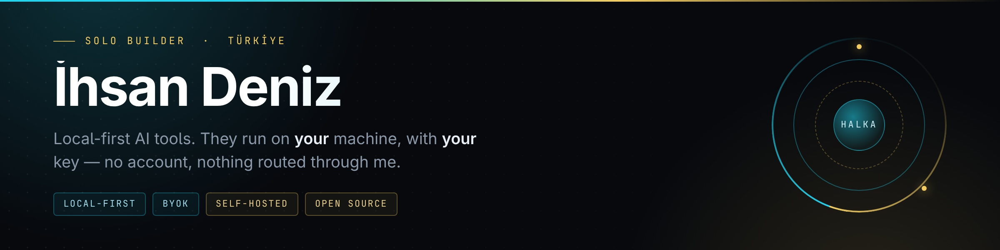
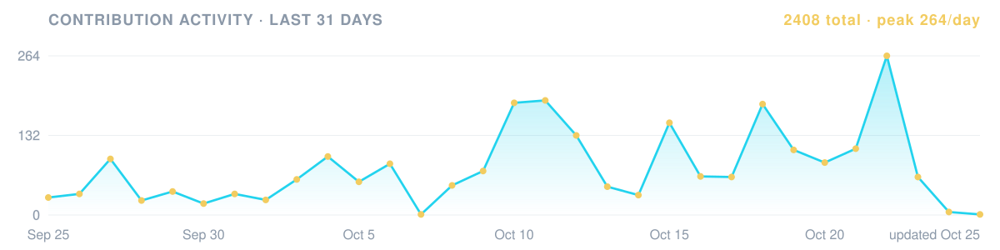

  <picture>
    <source media="(max-width: 600px)" srcset="./assets/header-mobile.png">
    
  </picture>

  <a href="https://github.com/ihsandeniz">
    <picture>
      <source media="(max-width: 600px)" srcset="./assets/activity-mobile.svg">
      
    </picture>
  </a>

  <a href="https://ihsandeniz.net.tr"><b>ihsandeniz.net.tr</b></a>
  &nbsp;&nbsp;·&nbsp;&nbsp;
  <a href="https://x.com/idkgen0"><b>X / @idkgen0</b></a>
  &nbsp;&nbsp;·&nbsp;&nbsp;
  <a href="https://www.threads.net/@idkgen0"><b>Threads / @idkgen0</b></a>

 

## What I am building now

<table>
  <tr>
    <td valign="top">
      FLAGSHIP / IN DAILY USE
      <h2><a href="https://ihsandeniz.net.tr/proje.html?p=alice">Alice AI — Yuki</a></h2>
      
<strong>A voice AI companion that lives on your machine, not on someone's server.</strong>

      

        Most AI companions are a browser tab in front of infrastructure you do not control:
        the conversations sit in someone else's database, the voice is rented, and the whole
        thing stops existing the day the service does.
      

      

        Yuki is a desktop app, and it is the assistant I use every day. Speech recognition runs on
        your own CPU (faster-whisper), long-term memory is a vector store on your own disk, and the
        model is whichever one you bring a key for. It ships with a large set of system tools:
        screen capture, files, web search and browsing, clipboard, media and window control,
        notifications, memory search.
      

      

        Two faces: a classic chat window, and <strong>HALKA</strong> — a ring HUD that sits on the desktop.
      

      

        <strong>A free Lite build is out for Linux</strong> — a single AppImage, nothing to install.
      

      

        <a href="https://ihsandeniz.net.tr/proje.html?p=alice"><b>project page</b></a>
        &nbsp;&nbsp;·&nbsp;&nbsp;
        <a href="https://github.com/ihsandeniz/yuki-ai/releases/latest"><b>download Yuki Lite</b></a>
      

    </td>
  </tr>
</table>

 

<table>
  <tr>
    <td width="66%" valign="middle">
      <h2>One person. No company, no team.</h2>
      

        Architecture, code, design, docs, deployment — all of it is me. I ship in public and I try
        not to announce anything I have not actually run. Where a project is unfinished, the README
        says so.
      

      

        The common thread across everything here: <strong>it runs on hardware you own.</strong>
        No account to create, no telemetry, and no service of mine sitting between you and your
        own data. You bring the key; the files stay where they are.
      

      

        <code>PYTHON</code>&nbsp;
        <code>FASTAPI</code>&nbsp;
        <code>TYPESCRIPT</code>&nbsp;
        <code>VANILLA&nbsp;JS</code>&nbsp;
        <code>RUST</code>&nbsp;
        <code>POSTGRES · PGVECTOR</code>&nbsp;
        <code>ARCH&nbsp;LINUX</code>
      

    </td>
    <td width="34%" align="center" valign="middle">
      
       
      <b>ihsandeniz.net.tr</b>
    </td>
  </tr>
</table>

 

## Open source

> Every one of these is a tool I use myself. Self-hosted, bring-your-own-key, no cloud account.

| Project | What it is |
| --- | --- |
| **[usage&#8209;tracker](https://github.com/ihsandeniz/usage-tracker)**   Python · MIT · v0.6.0 | A *Pane for Linux*: all your AI usage, rate limits and real dollar spend in one place — a waybar badge, a floating widget, or a web panel. Guided setup that shows you every line before it writes it, and undoes it from the same screen. stdlib Python + Vanilla JS, zero dependencies, loopback-only. |
| **[ajan&#8209;bekci](https://github.com/ihsandeniz/ajan-bekci)**   Rust · Apache-2.0 · v0.1.0 | A warden for terminal coding agents. Wrap Claude Code or Codex CLI with it, and when the agent exits — normally, because the terminal closed, or because it crashed — it sweeps the processes the agent left behind. On the measured test rig: 0 leaks in 30 wrapped runs across those three exit paths; the unwrapped agents leaked in 30 of 30. `tara` lists leftovers from dead agents, with an evidence level. Linux + Windows. |
| **[yuki&#8209;ai](https://github.com/ihsandeniz/yuki-ai)** | Release channel for the free Yuki Lite build — a single AppImage, nothing to install. |

 

## Upstream contributions

> Small fixes in tools I use every day. Merged:

- **[fastfetch](https://github.com/fastfetch-cli/fastfetch)** — [Vulkan driver name on multi-GPU systems](https://github.com/fastfetch-cli/fastfetch/pull/2620) · [DDC/CI brightness detection](https://github.com/fastfetch-cli/fastfetch/pull/2616) · [Turkish module names](https://github.com/fastfetch-cli/fastfetch/pull/2648)
- **[sysinfo](https://github.com/GuillaumeGomez/sysinfo)** — [process liveness after update (Linux)](https://github.com/GuillaumeGomez/sysinfo/pull/1769) · [reset errno before `getgrent`](https://github.com/GuillaumeGomez/sysinfo/pull/1762)
- **[fpdf2](https://github.com/py-pdf/fpdf2)** — [/CIDSet for PDF/A-1](https://github.com/py-pdf/fpdf2/pull/1968) · [CI build constraint](https://github.com/py-pdf/fpdf2/pull/1958) · [Turkish tutorial sync](https://github.com/py-pdf/fpdf2/pull/1951)
- **[pypdf](https://github.com/py-pdf/pypdf)** — [parameter rebinding](https://github.com/py-pdf/pypdf/pull/4131) · [protocol data members](https://github.com/py-pdf/pypdf/pull/4106)
- **[fontTools](https://github.com/fonttools/fonttools)** — [exact endpoints in curve splitting](https://github.com/fonttools/fonttools/pull/4194)
- **[three.js](https://github.com/mrdoob/three.js)** — [JSDoc default values](https://github.com/mrdoob/three.js/pull/35034)
- **[Waybar](https://github.com/Alexays/Waybar)** — [temperature `disable-on-sleep` docs](https://github.com/Alexays/Waybar/pull/5345)
- **[kitty](https://github.com/kovidgoyal/kitty)** — [config reload example](https://github.com/kovidgoyal/kitty/pull/10670)
- **[TypeGPU](https://github.com/software-mansion/TypeGPU)** — [expression stringification cleanup](https://github.com/software-mansion/TypeGPU/pull/3085)

<a href="https://github.com/search?q=author%3Aihsandeniz+is%3Apr+is%3Amerged+-user%3Aihsandeniz&amp;type=pullrequests">all merged pull requests →</a>

 

  

  Header art generated from <a href="./build">./build</a> — plain HTML, rendered locally. The activity graph is redrawn daily by a GitHub Action from GitHub's own API. No external services.

